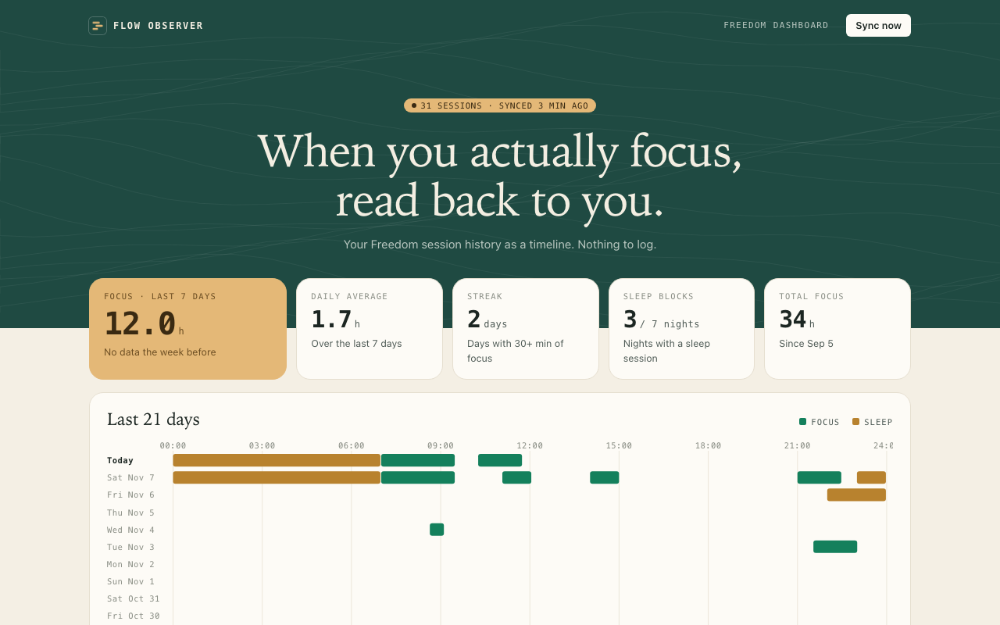
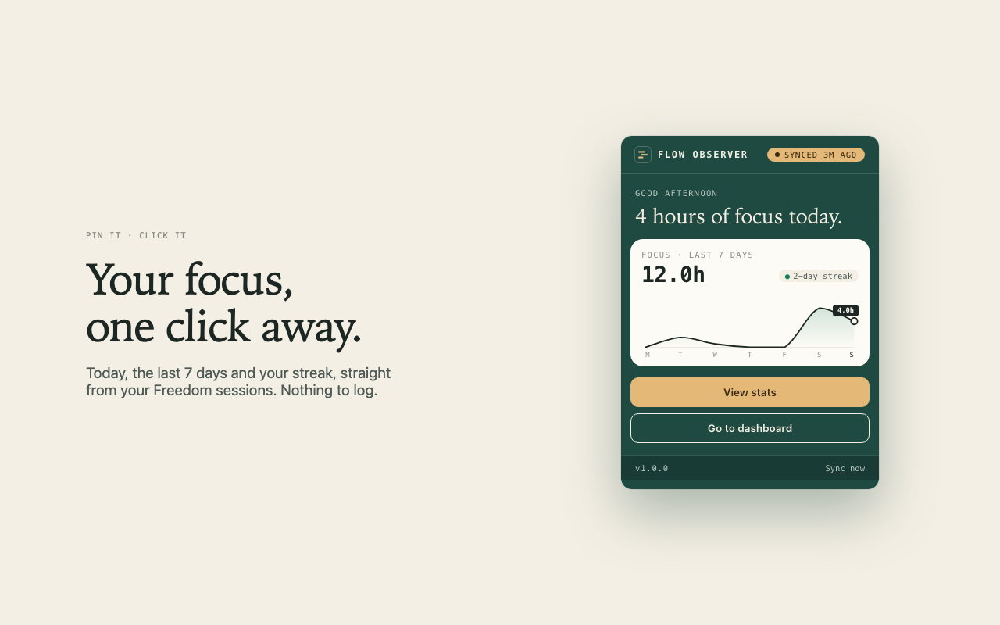
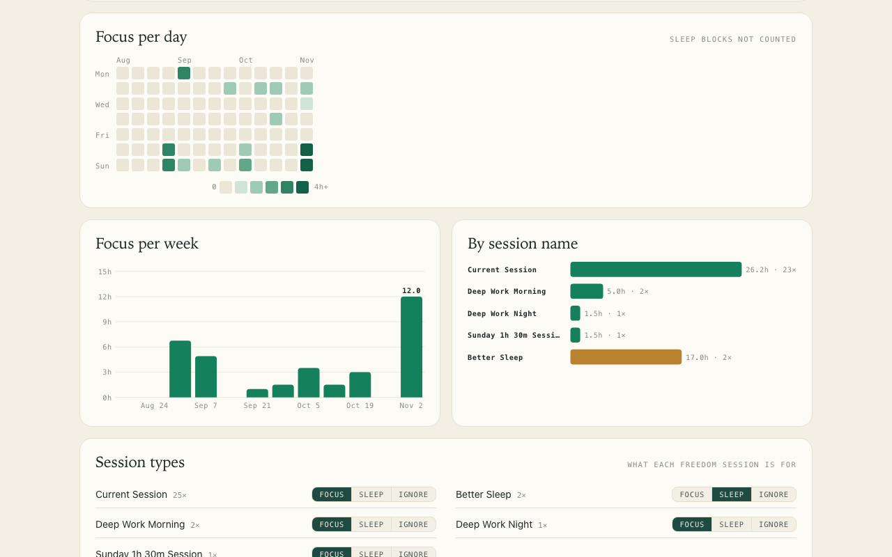

# Flow Observer for Freedom

**Passive focus stats for [Freedom](https://freedom.to) users.** A Chrome extension that reads your Freedom session history and shows when you actually focus: a 21-day timeline, a daily heatmap, weekly totals, and a one-click popup. You don't start timers or log anything.



| Popup | Charts |
|---|---|
|  |  |

## Why

I use Freedom to block distractions, and I tried logging each focus session by hand: type, note, rating. I couldn't keep it up. Freedom already records every session, so this extension skips the logging entirely and charts what's already there.

## Features

- **Popup**: today's focus, the last 7 days with a trend line, and your streak, plus *View stats* and *Go to dashboard*.
- **Stats page**: 21-day timeline across the 24 hours, daily heatmap, weekly totals, and totals per session name.
- **Session types**: mark each session name as Focus, Sleep or Ignore. Sleep blocks are shown but don't count toward focus.
- **Private**: data stays in `chrome.storage.local`. There's no server and no analytics, and the only host permission is `freedom.to`.

## How it works

- Freedom's website loads its Session History from `freedom.to/concluded_sessions`, a paginated JSON endpoint, newest first.
- A Manifest V3 service worker calls that endpoint with the user's existing freedom.to cookie. It runs every hour, when Chrome starts, and when the popup opens.
- Each sync stops at the first page it has already seen, so after the first run a sync is usually a single request.
- Charts are hand-written SVG with no libraries. The whole extension is about 400 lines of JavaScript.
- Sessions that cross midnight are split by local day, so a 23:00–07:00 sleep block counts toward both days correctly.

```
extension/
  manifest.json   MV3 manifest
  lib.js          sync, storage, and the stats math shared by every page
  bg.js           service worker: hourly alarm and on-demand sync
  popup.*         toolbar popup
  stats.*         full stats page
  theme.css       forest, sand and cream; serif headlines, mono labels and numbers
docs/             GitHub Pages: privacy policy
store/            Chrome Web Store listing text and images
```

## Install

From the Chrome Web Store (pending review), or from source:

1. Clone this repo.
2. Go to `chrome://extensions` and turn on **Developer mode**.
3. Click **Load unpacked** and choose the `extension/` folder.
4. Pin **Flow Observer** from the puzzle-piece menu. You need to be signed in at freedom.to.

## Limits

- `concluded_sessions` is Freedom's private web API. If Freedom changes it, sync stops and the popup shows *Sync failed*.
- A scheduled session counts as focus even if you weren't at your computer.

## Disclaimer

An independent project, not made by, affiliated with or endorsed by Freedom (80pct Solutions). "Freedom" is their trademark and is used only to say which app this works with.

[Privacy policy](PRIVACY.md)
